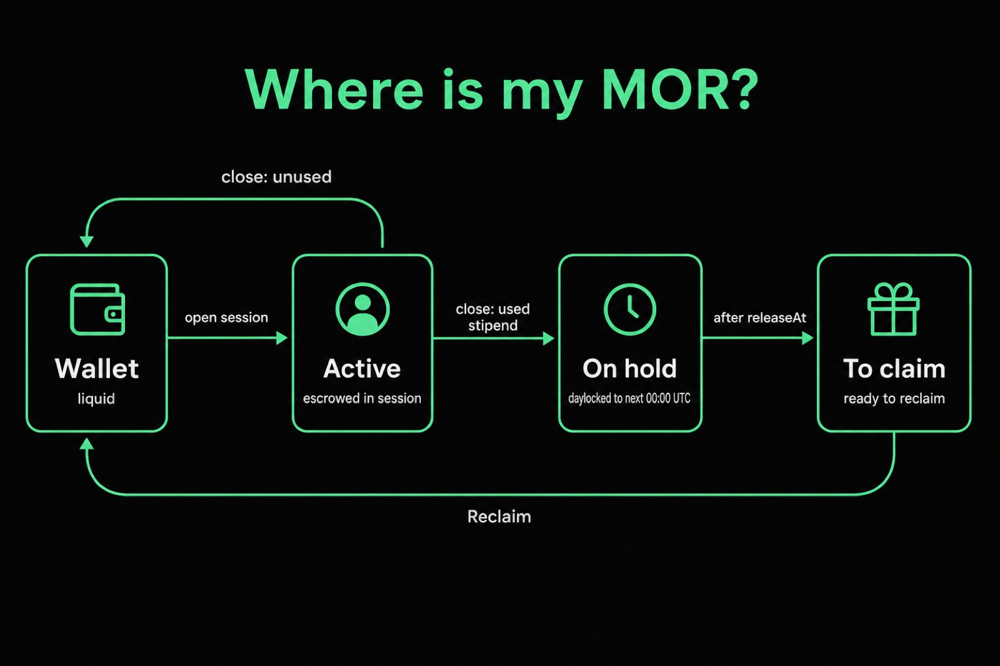

# 3. GUI basics

[← Bootstrap](02-bootstrap.md) · [Guide home](README.md) · [Next: Apps →](04-clients.md)

One topic at a time. You do not need every section on day one.

---

## Login

- URL: `https://<your-host>/gui/`
- User: `admin`
- Password: `ADMIN_PASSWORD`
- Two steps when 2FA is enrolled: password first, then the 6-digit code (or
  a recovery code). Wrong password and missing code get the same answer, so
  the page never reveals whether 2FA is enrolled; lockout and audit apply to
  both steps.
- Tabs: Status, API Keys, Probe, Sessions & Usage, Security, Settings (far right).
- Status, top to bottom: a status line (health or the reason it is not
  healthy, open sessions, versions), the four MOR numbers below, Connect a
  client, then Add MOR and Support (both collapsed). Hover or focus an &#9432; for help.
  There is no low-wallet warning: watch the Wallet number, and keep a
  little ETH on the wallet for gas (check it in your wallet app).
- Security: the **2FA switch** turns two-factor login on or off. It is off
  by default on every deploy (password-only login), and the tab shows a
  short note recommending turning it on; nothing is forced. Turning it on
  runs the enrollment: enter the admin password, start, scan the QR code,
  and confirm a code (the password is asked for again on confirm).
  Confirming signs out every other admin session; this browser stays
  signed in. Until a code is
  confirmed the tab shows one message, "Finish setup", and switching back
  off cancels the setup (after a reset, below, it cannot be switched off). 2FA is on once the code is confirmed, and 10
  recovery codes are shown once; save them.
  Each works once in place of the 6-digit code. The switch is stored in
  `DATA_DIR`, so it survives restarts and redeploys.
- Regenerate recovery codes, reset 2FA or turn it off from the same tab:
  the buttons (and switching off) need both the password and a current
  code or recovery code. Regenerate takes only a 6-digit authenticator
  code, not a recovery code.
- Admin sessions end after 4 hours without activity and 12 hours after
  login, whether 2FA is on or off; the Security tab shows both. Background
  refreshes do not count as activity. These lengths are fixed (no setting).
- Full API keys (copy, Probe, Export all) need a recent confirmation: within
  30 minutes of login or of the last confirmation. Otherwise the page asks
  for the password (and a 6-digit code when 2FA is on) and then continues.
- Turn off removes the 2FA secret and all recovery codes and signs out
  every session; the next login is password only.
- Reset wipes the 2FA secret and all recovery codes and signs out every
  session (you land on the login screen), but 2FA stays on. Log in with the
  password: only the Security tab shows, with a new enrollment and a new QR
  code, until it is confirmed; the old authenticator entry and old recovery
  codes no longer work.
- Locked out (lost authenticator and codes): emergency recovery is one
  restart with `UPLINK_RESET_2FA=true`, then remove it; 2FA comes back off
  ([details](06-developers.md#admin-2fa-and-recovery-codes)).
- **Security alerts** (below 2FA): the last 50 audit events (logins
  and lockouts, 2FA and key changes, boot session checks, provider
  failovers, balance drops),
  newest first. Each row reads time (local, `YYYY-MM-DD HH:MM:SS`) | event name
  (bold) | details, set as plain text. The filter box above the list hides
  rows that do not contain the typed text (case-insensitive). The list is
  loaded at boot from the audit files in `DATA_DIR`
  ([Audit streams](06-developers.md#audit-streams)), so it survives a
  restart; at least half of it is kept for admin and credential events. It
  loads once 2FA is enrolled or off; while an enrollment is required it says
  so instead.

---

## API Keys

| Kind | Survives a fresh deploy / volume wipe? | Role |
|------|---------------------------|------|
| **Master** | Yes (`API_KEY_SEED`) | Inference; admin API only with `MASTER_KEY_ADMIN=true` (default off), never on logout or 2FA status/enroll (cookie session only) |
| **Prompt** | Yes (`API_KEY_SEED`) | Inference only — default for clients |
| **Ephemeral** | No — export/import (kept across restarts and redeploys on the same data volume) | Named keys for apps/agents |

- Rotate built-ins by changing `API_KEY_SEED` and restarting. This also
  invalidates the 2FA secret and recovery codes; restart once with
  `UPLINK_RESET_2FA=true` to clear them, then remove it and enroll again
  ([details](06-developers.md#admin-2fa-and-recovery-codes)).
- Ephemeral: create, red trash to delete, **Export all** / **Import list**
  after a fresh deploy or a deleted data volume. A restart or redeploy on
  the same volume keeps them.

---

## Where is my MOR?

Opening a session moves stake from **Wallet → Active** (escrow for the full session duration). What happens next depends on **how the session ends** — not on how many tokens you prompted with.

| How the session ends | Liquid (back to Wallet on the close tx) | Time-locked (**On hold**) |
|----------------------|-----------------------------------------|---------------------------|
| **Close early** (GUI / housekeeping / router close before end) | Unused time portion of the stake | Used time portion |
| **Expire naturally** (session runs to its end time) | Nothing | **Entire** stake |

Then the clock:

1. **On hold** — daylocked until the next UTC midnight (`releaseAt`).
2. **To claim** — past `releaseAt`; ready to pull back.
3. **Reclaim** — `withdrawUserStakes` (Status button, or auto ~00:05 UTC) → **Wallet**.

| Bucket | Meaning |
|--------|---------|
| **Wallet** | Liquid MOR in the wallet |
| **Active** | Open session stake |
| **On hold** | Closed/expired stake still daylocked |
| **To claim** | Daylock done — reclaim to Wallet |

**Session stake (locks, not spends).** Stake is locked while a session runs
and returned to this wallet, held at most until the next UTC day. See
[02-bootstrap](02-bootstrap.md) for the full wording.

**Practical tip:** if you only need a short burst, close the session when you are done so unused duration returns immediately as liquid. If you leave sessions open until they expire, plan float for the **full** stake until the next reclaim cycle.

Deeper: [nodedocs — Where is my MOR?](https://nodedocs.mor.org/ai/where-is-my-mor) · [tech.mor.org/session.html](https://tech.mor.org/session.html)

---

## Sessions & Usage

- On boot Uplink lists the open sessions before opening any: still-valid
  ones are reused (one per model), expired and duplicate ones are closed so
  their stake is returned, and sessions for models not in the catalog are
  left to expire. The Status tab shows the last boot check and its counts.
  A graceful `docker stop` closes every open session on the wallet before
  Uplink exits, including sessions for models not in the catalog and, on a
  shared wallet, the other client's sessions; the stake is returned (a
  lock, not a loss). `CLOSE_SESSIONS_ON_EXIT=false` opts out. Use a
  dedicated wallet: the boot check and the stop act on every session of
  the wallet.
- A session with no call in flight and no use for 5 minutes
  (`UPLINK_SESSION_IDLE_GRACE_SECONDS`) is closed early so its unused stake
  returns. A session is never closed while a call is still running on it;
  apps can release their hold when done ([Long jobs](04-clients.md#long-jobs-timeouts-session-length-release)).
  The **Sessions** table shows, per session, when it opened and ends, the
  calls in flight and the holders (key ids in the tooltip).
- **Usage** counters are stored on the Uplink data volume: they survive
  restarts and redeploys, and reset on a fresh deploy or when the volume is
  deleted. Funds do not depend on them.
- Usage is counted per model registration: a call by name and a call by
  id to the same model land in one row, shown as `name (0x + 6 hex)`, for
  example `deepseek-v4-pro (0xb2c4a6)`. An id the catalog no longer lists
  shows its short id. Rows saved by an older version under a model name
  join the matching row when the name still resolves.

---

## Probe

1. Open **Probe**.
2. Pick a model (fuzzy search) and an API key.
3. **Run test**, or **Copy** the curl command.
4. Confirm a normal completion in **Response**.

---

## Settings

- Every operator setting that is not a secret, one row each: a toggle,
  number field, list or text field, with its default. The tooltip gives
  the range or values and says whether it applies at once or after an
  Uplink or router restart. **Save** stores it in `DATA_DIR`; **Reset**
  returns to the default. Saving a setting that applies after an Uplink
  restart asks for the password (and 2FA code) again, like key export.
- A value set in `.env` wins and is read-only, with a note to remove it
  from `.env` to manage it here. Router settings, `MASTER_KEY_ADMIN`,
  `WEB_PUBLIC_URL`, `ACTIVE_MODELS_URL` and `GATEWAY_BIDS_URL` are
  read-only (set in `.env`).
- `sessionRelease` turns the apps' session release
  (`POST /v1/sessions/release`) on or off.
- **Export settings** / **Import settings** download or load a settings
  file; both ask for the password (and 2FA code) again, like key export.
  An import with any invalid, unknown or secret entry changes nothing.
- Secrets (wallet key, ETH node URL, cookie, admin password, API key
  seed, master key) never show here: they stay in `.env`.
- Details: [Operator settings](06-developers.md#operator-settings).

---

## Logs & support

Router / container logs are **not** streamed into the GUI yet.

| Source | How |
|--------|-----|
| GUI Status | Health, version chips, MOR buckets, reclaim |
| Support JSON | Status → **Download support bundle** (no private keys) |
| Host logs | `docker logs <uplink\|proxy-router>` or your platform log panel |

---

[← Bootstrap](02-bootstrap.md) · [Guide home](README.md) · [Next: Apps →](04-clients.md)
